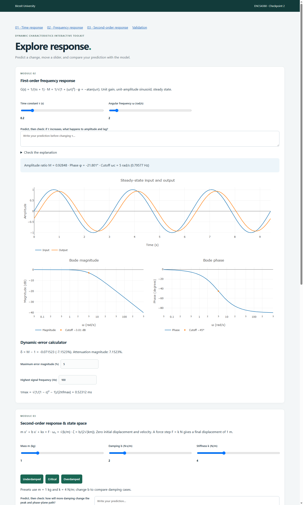

# ENCS4380 Dynamic Characteristics Toolkit

Team: Zaid, Ahmad, Anas and Khalid.

Live site: https://zaidbarham-droid.github.io/encs4380-dynamics-ZaidandAhmad/

Checkpoint 2: open `checkpoint.html` from the Module 1 navigation link.

## Modules
- Module 1: existing first-order step/ramp response and error plots.
- Module 2: sinusoidal steady-state response, magnitude/phase Bode plots, cutoff and dynamic-error calculator.
- Module 3: mass-spring-damper response, sampled response metrics, live state-space matrices, poles/eigenvalues and phase trajectory.

Module 2 and 3 ownership must be confirmed by the team; no contribution is attributed to another member by this update.

## Running and checking
Open `index.html` in a browser, or serve this folder with a static server. Plotly is loaded from a CDN and needs an internet connection. There is no backend or build step. Check `checkpoint.html` on desktop and mobile.

Run `node test-dynamics.cjs` to check reference values, the governing differential equation, all damping cases and slider extremes. The checkpoint page displays expected/calculated values and pass/fail results.

Module 3 uses closed-form responses with zero initial conditions. The force step is F=k, so displacement settles to 1 m. Rise time is 10–90%, settling time uses the 2% band, and peak time is applicable only to underdamped responses. Metrics are sampled estimates. The frequency module shows steady state, without the startup transient.

## AI assistance
Codex assisted with implementing Modules 2 and 3, integrating navigation, and numerical verification for Checkpoint 2. Team members must review and understand the equations and code before the lab demonstration.

## Remaining final-release work
Module 4 has been implemented and manually tested. The remaining final-release tasks include confirming team contributions, completing integration testing, merging the work into main, and publishing the final v1.0 release.

## Checkpoint preview

Verified in headless Microsoft Edge: all eight validation rows pass, all six plots render, frequency slider and three damping presets update, and the layout fits a 390-pixel viewport.

## Module 4 — Guess the Sensor Challenge

Implemented by: GitHub user 1190693-anas.

Module 4 is an interactive sensor-identification challenge accessible through `guess.html` and linked from the homepage.

### Features
- Random first-order and second-order sensor generation.
- First-order parameters: gain (K) and time constant (tau).
- Second-order parameters: damping ratio (zeta) and natural frequency (omega_n).
- Simulated measurement noise.
- Interactive response plots using Plotly.
- Predicted response overlay with a dashed line.
- Parameter accuracy checking within 10%.
- Score tracking for correct and total guesses.
- Hints for both sensor types.
- New Sensor button to generate another challenge.

### How to Use
1. Open `guess.html` in your browser.
2. Study the unknown sensor response.
3. Enter your estimated parameters.
4. Click Check My Guess to compare the responses.
5. Use Show Hint for guidance or New Sensor for another challenge.

### Files
- `guess.html`: User interface.
- `guess.js`: Sensor simulation, guessing, scoring, and plotting.
- `guess.css`: Module 4 styling.
- `physics.js` and `dynamics.js`: Reused sensor equations.

### AI Assistance
ChatGPT assisted with code development, explanations, debugging, and implementation review. The student manually tested both sensor types, prediction overlays, scoring, hints, and measurement noise in a browser.

