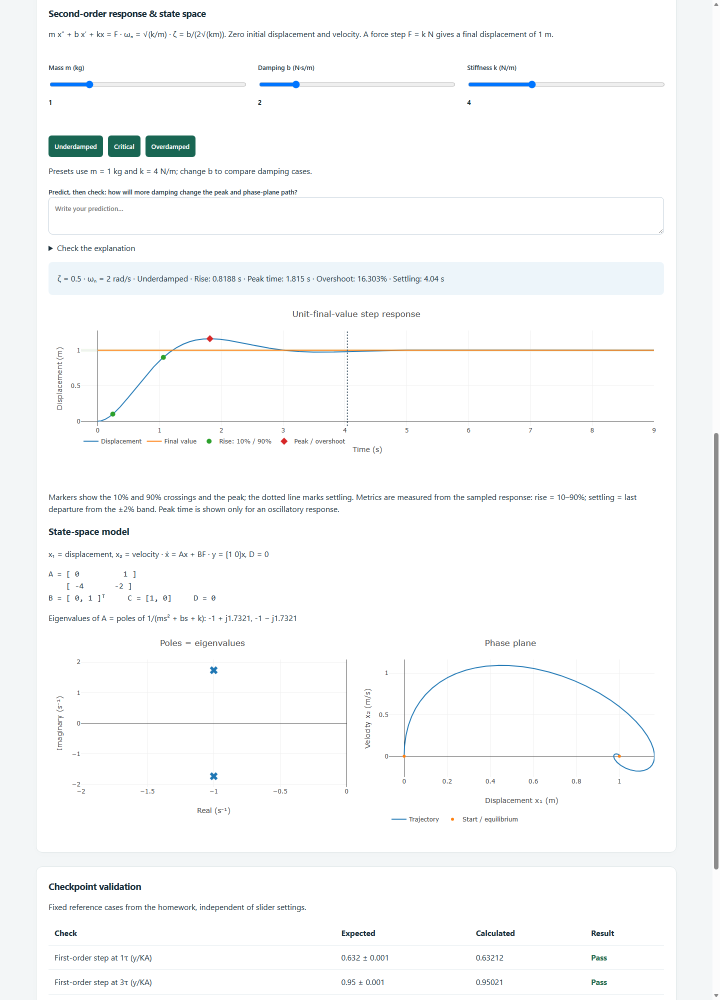
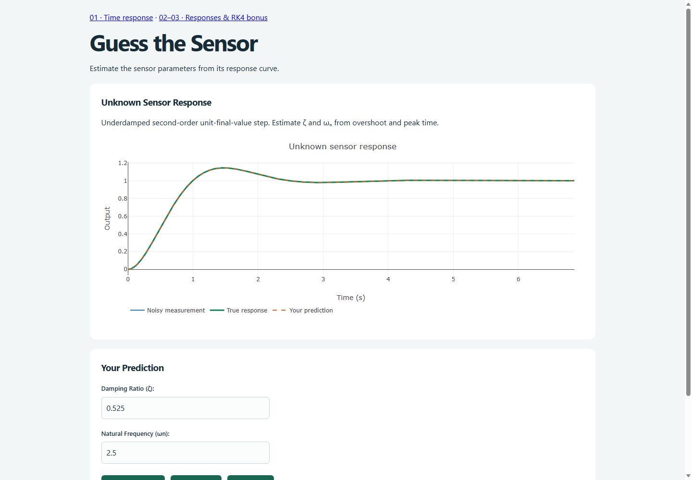
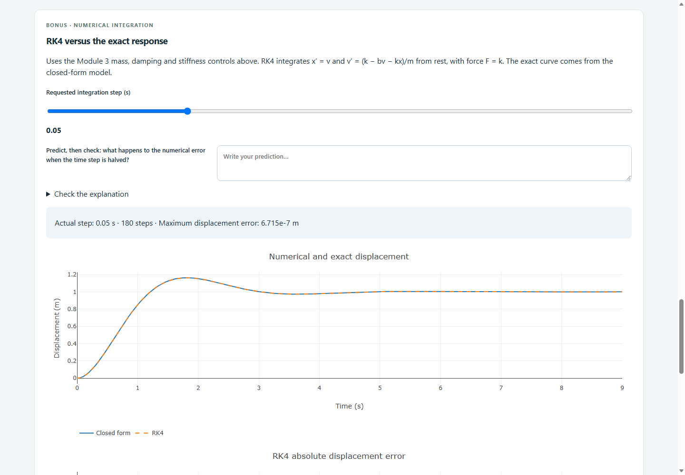

# ENCS4380 Dynamic Characteristics Toolkit

Team: Zaid, Ahmad, Anas and Khalid.

Published site: https://1190693-anas.github.io/ENCS4380-Micromouse/

The final implementation includes all four modules and the RK4 bonus.

## Run
Open `index.html` in a browser, or run `python -m http.server 8000` in this folder and open http://localhost:8000. Plotly loads from a CDN and requires internet access. No application server or build step is required.

## Modules
- **1 — Time response:** first-order step/ramp, gain/time constant controls, 63.2% and 95% markers, ramp lag/error and natural-log error slope.
- **2 — Frequency response:** input/output sinusoids, amplitude/phase, Bode plots, cutoff and dynamic-error calculator.
- **3 — Second order:** all damping cases, sampled response metrics and curve markers, live state-space matrices, poles/eigenvalues and phase trajectory. Force F=k gives unit final displacement.
- **4 — Guess the sensor:** noisy first-order step or steady-state sine and underdamped second-order step challenges. Guess before revealing the true parameters, clean response and prediction overlay. Both parameter errors within 10% earns one point; each round counts once. Hints and New Sensor are provided. The session score resets on reload. Sine frequency and unit input amplitude are stated. Second-order rounds are underdamped so overshoot/peak-time identification applies.
- **Bonus — RK4:** an independently implemented fourth-order Runge-Kutta solver integrates the mass-spring-damper state equations. Compare its displacement against the exact response and inspect absolute error. Module 3 controls update both models. Adjust the requested integration step; a cap of 0.25/(b/m + sqrt(k/m)) resolves fast modes. The actual step, step count and maximum error are displayed.

## Contributions
- **Ahmad and Zaid** worked together on Modules 1–3, including sensor models, plots, interface and integration. Both Ahmad and Zaid committed their work.
- **Anas and Khalid** worked together on Module 4, the Guess the Sensor challenge. Anas committed their joint work.

Commit authors identify who uploaded the changes; the paired contributions above describe the joint work.

## Micromouse project
The original Micromouse source files, ESP32 files, mazes and documentation are preserved in this repository. See [the original Micromouse README](MICROMOUSE-README.md) for that project's instructions.

## AI assistance
Codex/ChatGPT assisted with Modules 2–3, Module 4 development and completion, local integration, the RK4 solver, tests and documentation. Team members must review and understand every equation and implementation before the demonstration.

## Verification
Run:

```text
node test-dynamics.cjs
node test-final.cjs
```

The first suite verifies homework reference values, governing equations, damping cases, metric markers and extremes. The second checks RK4 across 45 parameter combinations, fourth-order convergence, and all three challenge types including invalid inputs, true-value reveal, round locking and resets. Halving the reference-case RK4 step reduces maximum displacement error by about 16.2 times.

Browser verification: ten reference rows pass; all eight checkpoint/bonus plots render; all damping presets and three challenge types work. All three pages fit a 390-pixel viewport. Response metrics are sampled estimates; sine responses exclude the startup transient.

## Screenshots





## Final submission steps
- Confirm the instructor has collaborator access to this submission repository.
- Submit the published Pages link and `v1.0` release link on the course page.
- Prepare for the group demonstration and individual code/equation questions.

Course-page submission and the demonstration must be completed by the team.
